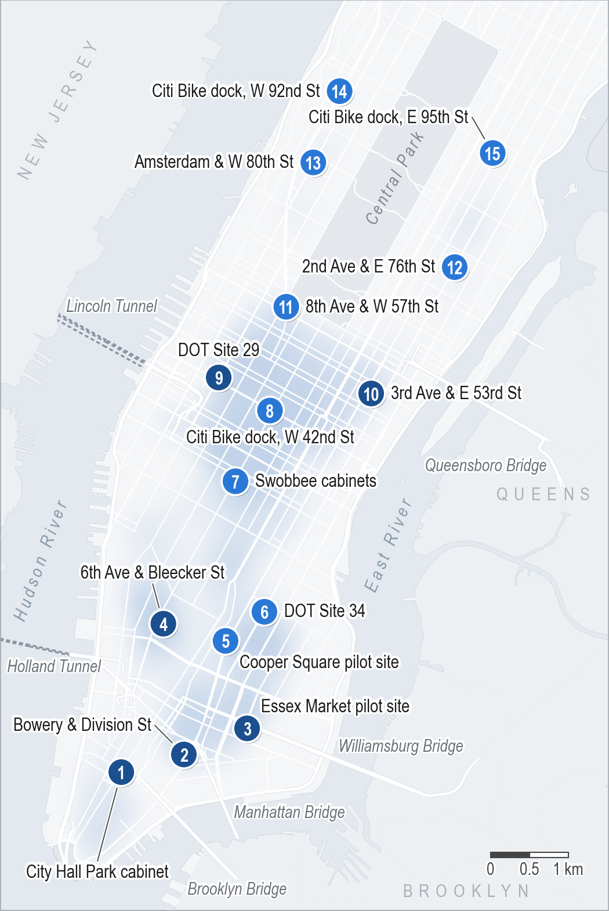
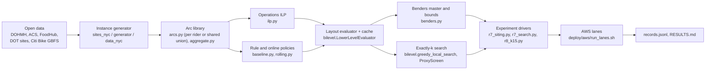
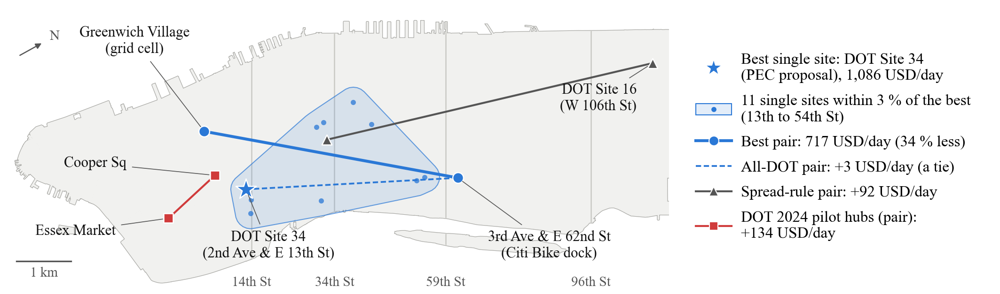
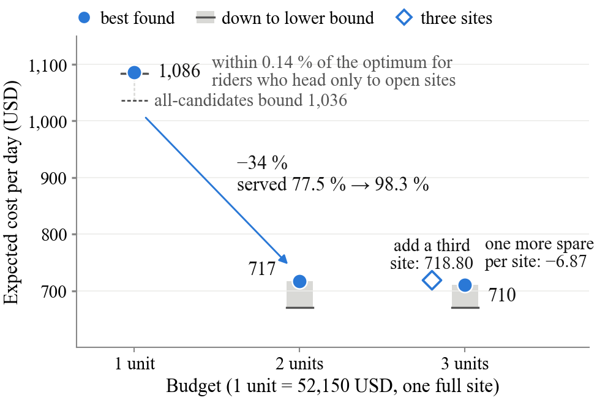
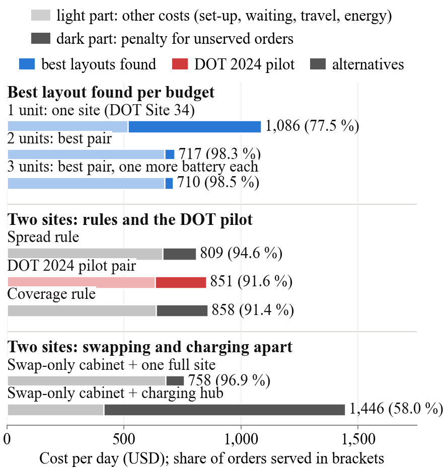

# Where to place e-bike battery-swapping stations in Manhattan

New York City is moving delivery e-bike charging out of homes. It must decide where public battery-swapping and
charging stations should go. Delivery platforms do not share trip data. So this repository builds a simulator of
e-bike battery swapping from **public data only** and uses it to choose station sites, roles and sizes in
Manhattan south of 110th Street. Two studies use it. For one to three stations and a small fleet, every answer
comes with a **lower bound**, so we know how far it can be from the best possible layout. For fifteen stations and
a city-scale fleet, riders follow a dispatch rule and the answer is the **best layout found**, compared with common
siting rules.

A paper reporting both studies is written for IEEE ITSC 2027.

**Short answer.** *One to three stations, 8 riders:* one station goes in the corridor between 13th and 54th Street;
DOT's proposed Site 34 (2nd Ave & E 13th St) is best. Two stations cut the daily cost by a third. Swap and charge at
the same site. Rule-based layouts and the 2024 DOT pilot pair cost 92-141 USD per day more.
*Fifteen stations, 64 riders:* put one within 1 km of each of the six bridge and tunnel entry points, five in the
restaurant-dense East Village and Midtown, and four north of 59th Street. Layouts from common siting rules cost
1,966-4,178 USD per day more.



*The fifteen sites, numbered south to north; dark badges: within 1 km of a bridge or tunnel entry; shading:
restaurant density (NYC DOHMH). Streets, bridges, tunnels and the New Jersey shore
© [OpenStreetMap contributors](https://www.openstreetmap.org/copyright) (ODbL); land and parks: the city's 2010
neighborhood tabulation areas (GeoDa Center).*

## 1. Method

### 1.1 The question

A planner has a budget in units of 52,150 USD. One unit buys one swap-and-charge site with 3 spare batteries and
2 chargers. For each budget the planner picks:

* **sites** from 59 candidates (45 from public records, 14 restaurant-dense grid cells);
* a **role** per site: swap-and-charge (SC), swap-only cabinet (S) or charging hub (C);
* a **size** per site: an SC site has $`B \in \{2,3,4\}`$ spare batteries and $`C \in \{1,2\}`$ chargers;
  a swap-only cabinet $`B \in \{2,3\}`$; a hub $`C \in \{2,4\}`$ (hubs only at 12 places).

A layout is scored by its expected **daily cost**: the evening's share of the set-up cost (a quarter of the day's
fixed cost, since the evening covers 4 of 16 operating hours) plus the operating cost of the 16:00-20:00 dinner
peak, as a weighted mean over 12 demand evenings. "Per day" means this per-evening cost throughout.

The first study prices budgets of one to three units with 8 riders and about 40 orders per evening. The second
asks where **15 sites** should go at a city-scale fleet: 64 riders start at the four East River bridges and the
Holland and Lincoln Tunnels with a quarter to half a battery, and 320 orders arrive per evening on average. The
planner opens exactly 15 SC sites of one unit each (782,250 USD), then may move spare batteries between them at
the same investment (every site keeps its 2 chargers). Each site has its own 1.4 kW power connection. Fifteen is a number we fixed in advance, not a model
result.

### 1.2 An open-data modular simulator

The simulator has six modules. Each can be replaced with better data or a better model without touching the rest.

| Module | What it does | Main code |
|---|---|---|
| Demand generation | Orders from restaurant inspections, census profiles and a public order sample | `generator.py`, `data_nyc.py`, `acs_weights.py` |
| Rider behavior | Coordinated plan (integer program) for one to three sites; dispatch rule for fifteen; own-choice riders as an alternative | `arcs.py`, `ilp.py`, `aggregate.py`, `baseline.py`, `rolling.py` |
| Station placement | Candidate sites, role and size menu, layout search with bounds (one to three sites) or without (fifteen) | `sites_nyc.py`, `bilevel.py`, `benders.py` |
| Battery stock and charging | Station stock by charge level, chargers, site and feeder power limits | `ilp.py`, `baseline.py`, `evaluate.py` |
| Swap queue and service | Swap positions and swap time per site | `ilp.py`, `baseline.py` |
| Policy limits and prices | Costs, time-of-use electricity, penalties | `costs.py`, `or_instance.py` |

### 1.3 Two-stage (bi-level) model

**Upper level (planner).** Binary $w_{l\psi}=1$ if option $\psi$ (role, $B$, $C$) is built at location $l$.
At most one option per location, total investment within $m$ budget units, at least one swap-capable site, and a
charge-capable partner for every swap-only cabinet. The layout is $x=(y,B,C)$.

```math
V(x)=\mathrm{setup}(x)+\sum_{\xi\in\Xi} p_\xi\,\mathrm{OPEX}_\xi(x),\qquad
V^*_m=\min_{x\in\mathcal X_m} V(x)
```

**Lower level (operations).** For a fixed layout and one evening $\xi$, $\mathrm{OPEX}_\xi(x)$ is the optimum of a
time-expanded integer program. Time has 48 slots of 5 min. A battery has 24 levels of 25 Wh. A rider state is a node
(place, time, charge level). The program chooses:

* **dispatch**: one path per rider through wait, reposition, delivery, swap and terminal arcs; each order is
  served once or left unserved (60 USD penalty);
* **swaps**: a swap takes a full battery out of the station and puts the rider's battery in;
* **level-indexed station stock** $n_{jqt}$ with the balance

```math
n_{j,q,t+1}=n_{jqt}-c_{jqt}+c_{j,q-1,t}+s_{jqt}-\mathbf 1[q=L]\,S_{jt}-D_{jqt}+A_{j,q,t+1}
```

* **charging**: at most $C_j$ batteries per slot, site power $P_j$, and a shared feeder limit;
* **transfers**: a timetabled service may move up to 6 batteries between two open sites within 2 km.

The cost is electricity + riding + transfers + unserved orders + response time and lateness. The follower minimises
the planner's own operating cost, so the bi-level model equals a two-stage stochastic integer program. The
fifteen-site study replaces this follower with a dispatch rule (section 1.5).

**Exact rider aggregation.** Riders with the same start node and the same arc set form a class. If every class is
closed, the per-rider binaries become integer flows on one union network with the same optimum (proved in the
paper; implemented as `ilp.build_model(aggregate=True)`). This makes the model several times smaller.

### 1.4 Upper and lower bounds

Pricing one layout means 12 integer programs of minutes each. So for each budget we report an upper bound
$`\mathrm{UB}_m`$ (the best layout found) and a lower bound $`\mathrm{LB}_m`$.

**Two rider conventions.** *All-candidates* riders may reposition toward any candidate, even a closed one (used for
the bounds only). *Open-sites* riders reposition only toward open sites and their own start points (the convention
of every reported cost). The open-sites library is a subset, so

```math
\mathrm{OPEX}^{\mathrm{all}}_\xi(x)\le \mathrm{OPEX}^{\mathrm{open}}_\xi(x).
```

Every priced cost (open-sites) is an upper bound under both conventions. Every all-candidates lower bound is valid
under both. Open-sites integer-program bounds are used only in open-sites statements.

* **Upper bounds:** open-sites pricing of candidate layouts.
* **Safe Lagrangian Benders cuts:** take any multipliers $\lambda$ of the scenario LP, project them to the dual
  sign, recompute the reduced costs $\tilde c=c-A^\top\lambda$, and use the column bounds:

```math
\Theta_\xi\ \ge\ \beta^0_\xi+\beta_\xi^\top x,\qquad
\beta^0_\xi=\lambda^\top b+\sum_{\text{cols}}\min\{\tilde c\,\underline\zeta,\ \tilde c\,\overline\zeta\},\quad
\beta_\xi=-T^\top\lambda .
```

  The cut holds at every layout whatever the solver accuracy. Integer L-shaped cuts and cover rows are added too.
* **Root LP:** all candidates open with free sizes, once per scenario; a floor for every layout.
* **Regional superset bound and pair screen:** opening a site only adds options (with relaxed end targets). So the
  LP with all sites of a region open and free sizes bounds every layout inside that region. For a pair of sites
  this gives a screen: drop the pair if its bound is above the best cost found.
* **Certificate:** budget $m$ is certified when $`\mathrm{UB}_m-\mathrm{LB}_m\le\max\{0.01\,\mathrm{UB}_m,1\}`$.
  At one unit all 236 layouts are enumerated with pruning.

Comparisons between layouts are paired on the same scenarios, with stratified 95 % intervals over six strata (three
demand levels, on weekdays and at weekends, two evenings each). The degrees of freedom follow the Welch-Satterthwaite
approximation. With two evenings per stratum they lie between 1 and 6, so the intervals are wide. Held-out
comparisons use the same six strata on 12 held-out evenings.

### 1.5 Fifteen sites: search without a bound

The integer program does not scale to 64 riders and 15 open sites: such an evening has 266-680 million rider arcs,
and already at 8 riders and 80 orders a 15-site evening kept a 94 % gap after 240 s. So the fifteen-site study
changes three things.

* **Dispatch-rule riders** (`baseline.run_baseline`, variant r2). Each order goes to the nearest rider who can serve
  it. A rider swaps at the nearest open site with a charged battery when its battery falls to a quarter, or earlier
  if it could not take the next order and still reach a site. Each site charges as many batteries as its swaps of
  the last hour suggest. Every schedule is checked by `evaluate.check` and priced with the same cost function.
* **One shared arc network** (`arcs.UnionArcLibrary`): the arcs of all riders are stored once, with one reachability
  mask per start place and charge, so memory does not grow with the fleet (about 2 GB per worker for an evening).
* **Search** (`bilevel.greedy_local_search` with `force_k=15`). Forward selection from four starts (the best pair
  of Finding 2, the best two sites of the coverage and of the spread rule, no site); at each step a distance screen
  (`bilevel.ProxyScreen`: order penalty times grid distance to the nearest open site) ranks the candidates and the
  three best are priced. Then site swaps, and a size polish that moves spares at the same investment. The search
  prices 6 of the 12 evenings.

There are $`\binom{59}{15}\approx 4.0\times 10^{13}`$ ways to pick 15 of 59 sites, and no lower bound was computed at
this size. So the study reports the best layout found, re-priced on 12 + 12 held-out evenings, the cost against the
number of sites, paired regrets against rule layouts, and an exact check of the dispatch rule at 16 riders.

## 2. Code logic



The arc library is shared by the ILP and the rule policies, so both are priced on the same moves. Every schedule
is re-checked by `evaluate.check`. The evaluator caches each (layout, scenario) solve. The master turns LP duals
into safe cuts. Every driver stage appends to `records.jsonl` and resumes from it. In the fifteen-site study
`r8_k15.py` prices the evenings in a pool of worker processes, each building its own union arc library.

### Main modules

All paths are under `ebike_swap_sim/`.

| Path | Role |
|---|---|
| `ebike_swap_sim/or_instance.py` | Data model: discretisation, riders, orders, facilities, transfer services |
| `ebike_swap_sim/generator.py` | Synthetic and round-5 instance families |
| `ebike_swap_sim/data_nyc.py`, `acs_weights.py` | NYC restaurants, census zone weights, order destinations |
| `ebike_swap_sim/sites_nyc.py` | Candidate sites (`manhattan_dot` and `manhattan15` families), size menu, layout to instance |
| `ebike_swap_sim/arcs.py` | Time-expanded arc library and pruning rules; one union library for all riders (a reachability mask per rider class) |
| `ebike_swap_sim/aggregate.py` | Exact rider aggregation and path decomposition (also on the union library) |
| `ebike_swap_sim/ilp.py` | Gurobi operations model, MIP starts, solution extraction |
| `ebike_swap_sim/evaluate.py` | Cost function, constraint checker and per-site metrics for any schedule |
| `ebike_swap_sim/baseline.py` | Event-driven rule policy (nearest rider, threshold swaps) |
| `ebike_swap_sim/rolling.py` | Rolling-horizon wrapper (online re-planning) |
| `ebike_swap_sim/bilevel.py` | `LowerLevelEvaluator`, search heuristics (with an exactly-k mode and a distance screen), rule baselines |
| `ebike_swap_sim/benders.py` | Scenario LPs, safe cuts, cut pool, master, subset bounds |
| `ebike_swap_sim/costs.py` | Cost calibration in USD |
| `experiments/r7_siting.py` | Siting driver: setup, feas, rootlp, m1, comparison, restricted, oos, analyse |
| `experiments/r7_search.py` | Search driver: pairs, m3, roles, oos, noradius, price-list, ub-check, report |
| `experiments/r7_gate.py`, `r7_cost.py` | Pre-run gate check; compute-cost summary of `cost.jsonl` |
| `experiments/r8_k15.py` | Fifteen-site driver: instances, dryrun, validate, search, final, report |
| `tests/` | 535 pytest checks |

### Install

Python 3.12 and Gurobi (`gurobipy` 13) with a licence. A free academic licence works.

```bash
git clone https://github.com/yuanmingchen922/Ebike_battey_swap.git
cd Ebike_battey_swap
python3.12 -m venv .venv && . .venv/bin/activate
pip install -r deploy/aws/requirements.txt
export GRB_LICENSE_FILE=/path/to/gurobi.lic   # never commit the licence
```

`import ebike_swap_sim` works without Gurobi; only the solver modules need it.

### Tests and a smoke run

```bash
cd ebike_swap_sim
python3 -m pytest                                   # pytest.ini sets the path
PYTHONPATH=. python3 experiments/e1_toy.py          # toy example, optimum 12.5
PYTHONPATH=. python3 experiments/r7_siting.py --smoke --stage all   # toy siting run -> outputs/r7_siting_smoke/
PYTHONPATH=. python3 experiments/r8_k15.py --smoke --stage all      # toy fifteen-site run (4 candidates, k = 2), seconds
PYTHONPATH=. python3 experiments/r7_siting.py --stage setup --dry-run --lp-workers 1 --price-workers 1   # sizes of the real instance, no solve (several minutes)
```

### The production siting run

The production run of the one-to-three-site study uses the `manhattan_dot` family: 59 candidates, 12 scenarios
plus 12 held-out, 8 riders, 14-block approach radius. It ran on one AWS r7i.4xlarge in 48.1 instance hours
(50.87 USD). Layouts costed later with `r7_search.py --stage price-list` (in-range hubs, further three-unit layouts,
the hub as a third unit, held-out evenings) took 13.6 more instance hours (14.38 USD); their records and results
are in `ebike_swap_sim/outputs/r7_completion/`.

1. `r7_siting.py --stage feas` screens which sites can work alone.
2. `r7_siting.py --stage rootlp` solves the root LP per scenario.
3. `r7_siting.py --stage m1` enumerates one-site layouts; `r7_search.py --stage price-list --tier open_sites`
   prices the open-sites list.
4. `r7_search.py --stage pairs`, `m3`, `roles` search two and three units.
5. `r7_siting.py --stage comparison` and `restricted` price the rules, the DOT pilot pair and the DOT-only search.
6. `r7_search.py --stage oos` and `noradius` re-price on held-out scenarios and without the approach radius.
7. `r7_siting.py --stage analyse` and `r7_search.py --stage report` write `RESULTS.md` and `SEARCH.md`.

All stages share `--out-dir` (default `outputs/r7_siting/`) and resume from its records. The lane plans are written
with `--write-lanes` (`r7_search.py --write-lanes --lanes-plan r2` writes
`outputs/cloud_lanes_siting_prod/lanes_r2.txt`). On AWS (`deploy/aws/`):

```bash
# laptop
deploy/aws/sync_up.sh                 # code and data to the server (copy the lanes_r2* lane plans by hand)
deploy/aws/upload_licence.sh          # Gurobi licence to the server (mode 600)
# server (~/battery_swap)
bash deploy/aws/bootstrap.sh          # venv, licence check, toy optimum 12.5, smoke stage
bash deploy/aws/r7_prod_check.sh      # pre-flight check of code and lane plans
. env.sh                              # venv, licence, cd ebike_swap_sim
# batches 0-3 of lanes.txt (gate, feasibility, one-site pass, root LPs) run first; lanes_r2.txt continues from there
bash ../deploy/aws/run_lanes.sh start outputs/cloud_lanes_siting_prod/lanes_r2.txt
bash ../deploy/aws/run_lanes.sh status outputs/cloud_lanes_siting_prod/lanes_r2.txt
# laptop
deploy/aws/sync_down.sh               # results back
```

Copy `deploy/aws/aws_env.example.sh` to `aws_env.sh` first (git-ignored). Final report of the
production run (24 October 2026): `ebike_swap_sim/outputs/r7_prod_final/RESULTS_final.md`; later runs:
`ebike_swap_sim/outputs/r7_completion/RESULTS_completion.md`.

### The fifteen-site run

The fifteen-site study uses the `manhattan15` family (the candidates and data of `manhattan_dot`, 12 scenarios plus
12 held-out, 14-block approach radius) at 64 riders (`--n-bikes 64`; the family default is 48). One driver,
`experiments/r8_k15.py`, runs it in stages that share `--out-dir` and resume from its records and cache:

1. `--stage instances` builds and saves the 24 evenings once.
2. `--stage dryrun` checks three gates: at most 45 s and 4 GB per evening priced, and a median site with at least
   3 swaps. At 48 riders the median site made 2.5 swaps (`outputs/r8_k15/dryrun.json`), so the study runs at 64.
3. `--stage search` runs the four starts, the site swaps, the size polish and the cost path up to 20 sites.
4. `--stage final` re-prices on 12 + 12 evenings, closes each site once, and writes `layout.json` and
   `site_stats.csv` (the map inputs).
5. `--stage validate` runs the exact check; `--stage report` writes `RESULTS.md`.

The result of record adds `--grid-kw 1000`, which lifts the shared 2 kW limit so that each site keeps only its own
1.4 kW connection. Its size polish was then re-run to convergence (`--stage search --redo --polish-rounds 30`, then
`--stage final --redo`; the default is 3 rounds). It ran on one AWS r7i.4xlarge in 2.18 instance hours (2.31 USD,
the re-run included), reusing the evenings of the shared-supply run; that run and the 48-rider trial took another
4.1 instance hours (4.35 USD). `--write-lanes` writes the 48-rider plan `outputs/cloud_lanes_k15/`; the 64-rider
plans are `outputs/cloud_lanes_k15sp/` (result of record) and `outputs/cloud_lanes_k15n64/` (shared supply). On AWS:

```bash
# laptop (licence and bootstrap as above)
deploy/aws/sync_up.sh --code-only             # code and data; copy ebike_swap_sim/outputs/cloud_lanes_k15*/ by hand
# server (~/battery_swap)
bash deploy/aws/r8_prod_check.sh --smoke      # pre-flight: code markers, 48-rider k15 plan (not k15sp), toy run of every stage
export LANES_DIR=$PWD/ebike_swap_sim/outputs/cloud_lanes_k15sp
bash deploy/aws/run_lanes.sh start $LANES_DIR/lanes.txt --max-threads 12
bash deploy/aws/run_lanes.sh status           # or: run_lanes.sh logs ksp_search 40
# laptop
deploy/aws/sync_down.sh --path ebike_swap_sim/outputs/r8_k15_sp   # results back (into cloud_results/)
```

Final report: `ebike_swap_sim/outputs/r8_k15_sp/RESULTS.md`. Its dry-run line, like that of `r8_k15_n64`, prints a
fixed label, "go: 48 riders / 240 orders"; both runs used 64 riders (`n_bikes` in `layout.json`).

## 3. Results

All values are USD per day, set-up included. Every cost is an open-sites cost. Findings 1-4 come from the
one-to-three-site study (8 riders, coordinated plan), Findings 5-7 from the fifteen-site study (64 riders, dispatch
rule). Dollar values are comparable only within a study.

Intervals in Findings 1-4 use Welch-Satterthwaite degrees of freedom (section 1.4) and include the completion runs of
4-9 November 2026: 12 held-out evenings for every comparison, the in-range hubs, the four-spare listed-site pair, the
second three-site layout and the hub as a third unit. `notes/verify/r7_completion_facts.py` re-derives them from the
records in `ebike_swap_sim/outputs/r7_completion/` (table: `RESULTS_completion.md` in that folder).
`ebike_swap_sim/outputs/r7_prod_final/RESULTS_final.md` predates these runs: it has the same point values with
narrower 6-df intervals and held-out values for six weekday evenings only.

| Budget | Best layout found | Cost | Lower bound | Gap |
|---|---|---|---|---|
| 1 unit | DOT Site 34, open-sites riders | 1,085.87 | 1,084.31 | **0.14 %** (certified) |
| 1 unit | same, all-candidates riders | 1,085.87 | 1,036.03 | 4.59 % |
| 2 units | Greenwich Village grid cell + Citi Bike dock 3rd Ave & E 62nd St | 716.85 | 670.23 | 6.50 % |
| 2 units | listed-site pair: Site 34 + the same dock | 719.60 | | |
| 3 units | best pair, 4 spares each | 709.98 | 670.23 | 5.60 % |

### Finding 1: one site belongs in a corridor, led by DOT Site 34

* Site 34 (2nd Ave & E 13th St) costs 1,085.87 and serves 77.5 % of orders.
* For open-sites riders it is certified within 0.14 % of the best single site.
* For all-candidates riders the gap is 4.59 %; Site 34 is not proven best there.
* Ten more sites lie within 3 % of it, all between 13th and 54th Street. Only 23 of 59 candidates can work alone.
* The approach radius changes the order: without it three Midtown sites tie and Site 34 is eighth.



*The dashed pair, labelled "All-DOT pair" in the legend, is the listed-site pair of Finding 2.*

### Finding 2: a second site cuts cost by a third

* The best pair costs 716.85: 34 % less than one site. It serves 98.3 % of orders.
* Unserved orders fall from 9.5 to 0.74 per day. On 12 held-out evenings one site still costs $385.40 \pm 84.22$
  more than two.
* The listed-site pair (Site 34 + the E 62nd St dock, both from public records, no grid cell) costs 719.60, only
  $2.75 \pm 24.36$ more. Held out, the two pairs tie ($-0.31 \pm 2.53$).
* The two pairs cannot be ranked. Four evenings of each stopped at the solver's time limit, so the best pair may
  cost up to 4.5 less and the listed-site pair up to 6.5 less. A planner limited to listed sites pays at most 7.2
  more per day.
* A third budget unit buys batteries, not a third site: one more spare at both sites gives 709.98, a gain of
  $6.87 \pm 5.32$. The listed-site pair with four spares each costs 709.84, a tie with 709.98 ($0.14 \pm 5.33$
  less).
* Two three-site extensions of the best pair were priced: the best pair plus each of the two best single sites. With Site 34 it costs
  718.80, $8.82 \pm 9.12$ more than the four-spare pair. With the Citi Bike dock at E 14th St it costs 717.55,
  $7.56 \pm 10.27$ more. The 12 planning evenings do not separate either difference from zero; on the 12 held-out
  evenings both do ($7.79 \pm 3.36$ and $7.90 \pm 3.30$ more). No bound rules out a better three-site layout.



### Finding 3: swap and charge at the same site

A charging hub does not swap. Its batteries reach riders only by transfer to a swap site within 2 km. All extra
costs below are against the best pair.

* **Hub out of transfer range** (W 92nd St or W 42nd St, with a swap-only cabinet at the Greenwich Village grid
  cell): $728.92 \pm 124.87$ more. The hub stands idle and the cabinet serves 58.0 % of orders from its three spares.
* **Hub within range** (W 13th St, Bowery or Kenmare St, 1.2-1.65 km from the cell): transfers run, but the cabinet
  with a hub still costs $619.10 \pm 89.55$, $659.11 \pm 81.71$ and $659.09 \pm 80.90$ more.
* **Full site at the cell with one of these three hubs:** $441.54 \pm 91.46$, $443.59 \pm 88.96$ and
  $446.16 \pm 82.86$ more. Each costs more than Site 34 alone. Seven to nine of the 12 evenings of each stopped at
  the solver's time limit, so each may cost up to 19.8-28.8 less.
* On 12 held-out evenings the six in-range hub layouts cost 459-675 more and the out-of-range layout 731 more. All
  intervals are above zero.
* So even within transfer range, a hub never paid in place of a second swap site.
* A swap-only cabinet does far better than a hub: a cabinet at the E 14th St dock, with the full site at the
  E 62nd St dock, costs $41.49 \pm 14.92$ more (96.9 % of orders served).

* **Hub as a third unit** (a four-charger hub at W 13th St, Bowery, Kenmare St or E 72nd St, added to the best pair):
  28.44-29.98 more than the best pair (27.53-31.95 on the held-out evenings), about the hub's own set-up cost of
  29.52. No battery is transferred in any of the 96 solves, so the hub is never used. Against the four-spare pair the
  W 13th St hub costs $36.85 \pm 8.76$ more ($31.77 \pm 5.94$ held out; proven range [30.80, 76.60]).

### Finding 4: better than rules and the 2024 pilot

| Two-site layout | Extra cost (in sample) | Held-out (12 evenings) | Open-sites regret interval |
|---|---|---|---|
| Spread rule | $+91.70 \pm 75.33$ | $+60.30 \pm 55.66$ | [89.09, 138.33] |
| DOT 2024 pilot pair (Cooper Sq + Essex Market) | $+134.42 \pm 55.41$ | $+130.72 \pm 123.75$ | [130.86, 181.04] |
| Coverage rule | $+141.48 \pm 53.09$ | $+129.91 \pm 122.02$ | [136.19, 188.10] |

Held-out values cover 12 held-out evenings (seeds 100-111, weekdays and weekends) that were not used to choose the
layouts. All three intervals are above zero, in sample and held out. The regret interval is the proven range of the
extra cost over the best possible layout. The losses come almost entirely from 2.4 to 3.7 unserved orders per day.
The best pair puts one site on each side of the island.



### Finding 5: with fifteen sites, start at the bridges and tunnels

Run: `ebike_swap_sim/outputs/r8_k15_sp/` (64 riders, dispatch rule, each site on its own connection); the map is at
the top of this page.

* The best layout found costs 8,642.1 (95 % CI 7,027.3-10,256.8) and serves 88.2 % of orders; held out, 8,977.9.
* **Gateways (map 1-4, 9, 10):** one site within 1 km of each entry point: City Hall Park cabinet (Brooklyn
  Bridge), Chinatown grid cell at Bowery & Division St (Manhattan Bridge), Essex Market pilot site (Williamsburg
  Bridge), Greenwich Village grid cell at 6th Ave & Bleecker St (Holland Tunnel), DOT Site 29 at 9th Ave & W 42nd St
  (Lincoln Tunnel), Midtown East grid cell at 3rd Ave & E 53rd St (Queensboro Bridge). Riders enter with a quarter
  to half a battery, so many swap soon after. These are the six busiest sites (7.6-8.0 swaps per evening); closing
  one costs 1,019-1,515 more.
* **East Village and Midtown (5-8, 11):** Cooper Square pilot site, DOT Site 34, Swobbee cabinets at 836 6th Ave,
  Citi Bike dock on W 42nd St, Midtown grid cell at 8th Ave & W 57th St.
* **North of 59th Street (12-15):** grid cells at 2nd Ave & E 76th St and at Amsterdam Ave & W 80th St, Citi Bike
  docks on W 92nd St and E 95th St. Only 16 % of the restaurants are here, but 41 % of the orders are delivered here.
* Every site has 2 chargers. Sites 1-5, 9 and 10 hold 4 spares, site 14 holds 3 and the other seven hold 2. Cooper
  Square makes 6.6 swaps per evening and the other eight sites 2.8-4.3. With 3 spares at every site the same sites
  cost $1{,}077.5 \pm 421.0$ more ($1{,}057.9 \pm 418.9$ held out).
* The pattern by area is firm; the exact sites are not. With 3 spares at every site, two other search starts end at
  other site sets that tie with ours, and the start from no site ends 617 higher, within noise ($\pm 1{,}327$).
  Closing site 7, 8 or any of 11-14 alone raises the cost by an amount whose interval includes zero.
* Under one shared 2 kW supply the best layout found also has a site at every entry point
  (`ebike_swap_sim/outputs/r8_k15_n64/`).

### Finding 6: common siting rules cost 1,966-4,178 USD per day more

| Fifteen-site layout | Extra cost (in sample) | Held-out (12 evenings) | Orders served |
|---|---|---|---|
| Spread rule | $+1{,}965.9 \pm 1{,}561.6$ | $+2{,}401.9 \pm 382.5$ | 80.0 % |
| k-median | $+2{,}546.6 \pm 895.2$ | $+2{,}675.7 \pm 603.8$ | 78.1 % |
| Coverage rule | $+3{,}695.3 \pm 1{,}571.5$ | $+3{,}951.2 \pm 864.8$ | 71.2 % |
| DOT-first | $+3{,}778.6 \pm 1{,}530.6$ | $+4{,}320.8 \pm 419.6$ | 71.9 % |
| Access rule | $+4{,}177.6 \pm 385.5$ | $+4{,}227.2 \pm 629.6$ | 68.6 % |

k-median minimises the restaurant-to-site distance; DOT-first takes DOT pilot sites and PEC sites first; the access
rule ranks sites by inverse-distance access to restaurants. All intervals exclude zero, in sample and held out.
Against our sites with 3 spares each, the rule layouts still cost 888-3,100 more. Unserved orders make 78-91 % of
each rule's extra cost; coverage, DOT-first and access also leave 18-34 % of the land more than 14 blocks from a
site.

### Finding 7: cost keeps falling beyond fifteen sites

| Open sites (3 spares each) | 1 | 2 | 5 | 10 | 15 | 20 |
|---|---|---|---|---|---|---|
| Daily cost | 18,182.6 | 17,608.2 | 15,567.4 | 12,447.3 | 9,719.5 | 8,761.3 |
| Orders served | 10.7 % | 19.4 % | 40.8 % | 67.8 % | 84.9 % | 89.9 % |

One site is DOT Site 34 and two sites the best pair of Finding 2; the other points lie on the search paths and are
not the best cost for each number of sites. Each added site saves about 190-680 a day against 13.19 of set-up.
Twenty sites with 3 spares each cost $958.2 \pm 202.0$ less than our fifteen with 3 spares each. They tie with the
polished fifteen ($119.2 \pm 323.9$ more in sample, 282 less held out): fifteen is a number we fixed, not the
cheapest.

### Context

* **DOT 2024 pilot:** five public charging and swapping hubs (March-September 2024, swapping until February 2025);
  two of them, Cooper Square and Essex Market, lie in our area.
* **PEC programme:** DOT's Public E-Bike Charging programme has proposed 50 sidewalk sites citywide and will keep
  about 25; a vendor call is planned for late 2026.
* **Site 34:** a PEC proposal at the southeast corner of 2nd Ave and E 13th St, about 600 m in a straight line from
  Cooper Square (six blocks, about 900 m, on the model's street grid).

### Checks on the operations model (earlier rounds)

* Against the best of three rules, the coordinated plan is 25.1 % cheaper (95 % CI 20.2-30.1) on 30 synthetic
  instances and at least 27.9 % cheaper (24.2-31.6) on 10 Midtown instances. 99.8 % of the saving comes from
  serving more orders sooner.
* Rolling re-planning keeps about half of that saving (ratio of means 0.42 and 0.53).
* No battery moved by transfer in 45 solves without end targets.
* Removing on-site charging costs 262.96 USD more per window (216.81-309.11).

Sources: `ebike_swap_sim/outputs/R6_DIGEST.md` and `R6_FILL_DIGEST.md`.

### What is proven and what is not

* **Proven:** Site 34 is the best single site within 0.14 % for open-sites riders. For open-sites riders, the rule
  and pilot layouts lose at least 33-136 USD per day (all regret intervals above zero).
* **Not proven:** the one-site optimum for all-candidates riders (gap 4.59 %). The two- and three-unit answers are
  the best found by a heuristic pair search (gap 5.6-6.5 %); 11 screened pairs could not be ruled out.
* **Not proven (fifteen sites):** the layout is the best found, with no bound. Its lead over the rule layouts is a
  paired statistical result under dispatch-rule riders; nothing was solved exactly at 64 riders and 15 sites.
* **Exact check (fifteen sites):** at 16 riders and five sites (9 of 9 solved to optimality) the rule costs 1.65-2.56
  times the exact optimum (median 2.10) and ranks three layouts in the same order, but the optimum separates them
  far less (by 7.7 and 45.1, not 207.8 and 607.5): Finding 6's dollar gaps hold for dispatch-rule riders only.

### Limitations

* One to three sites: 12 demand evenings, 8 riders and about 40 orders per evening, checked on 12 held-out
  evenings. With two evenings per stratum the intervals have 1 to 6 degrees of freedom and are wide.
* A four-hour evening leaves transfers little time to pay. End-of-evening stock is not valued.
* In the one-to-three-site study riders follow a coordinated full-information plan; real online costs would be
  higher.
* Fifteen sites: the dispatch rule costs about twice the exact optimum at small scale. Only the best start's layout
  had its spares moved.
* The spare polish ran until none of the three most promising moves improved (six accepted moves). It takes the
  first improving move, not the best. One layout it priced but did not take, differing by one spare, costs
  $41.7 \pm 127.6$ less in sample and $51.0 \pm 138.9$ more held out: a tie.
* About 4.6 of the 64 riders per evening end queued at a site below the battery reserve; the rule reports this but
  does not prevent it, and the cost does not charge it.
* Charging one or two unserved-order penalties per such rider changes no comparison with the five siting-rule
  layouts.
* Each of the fifteen sites has its own 1.4 kW connection, and two chargers draw at most 0.67 kW: chargers and
  spares bind, not power (riders wait 32-64 minutes on average at the six gateway sites).
* With one shared 2 kW supply, as in Findings 1-4, the same rule layouts cost 788-1,270 more and serve 7.5-9.6
  points fewer orders, partly because the rule hands a shared supply to the sites in site-number order.
* Citi Bike docks stand in for "a sidewalk place with power". Grid cells are not addresses. Cabinet space and
  owner consent were not checked. DOT Site 29, a fifteen-site gateway, is opposed by its community board.

## 4. Reference reading

1. D. Ding, Z. Li, J. Zhang, X. Liu, J. Zhang, Y. Li, P. Cai, J. Liu, G. Long. "eBaaS: AIoT-Enabled eBike
   Battery-Swap as a Service for Last-Mile Delivery." *Proc. ACM Web Conference (WWW '25)*, 2025, pp. 5045-5053.
   https://doi.org/10.1145/3696410.3714503. *Use:* energy calibration (25 Wh/km) and the 2 km service radius.
2. W. Li, Z. Li, X. Liu, R. Zhu, Z. Zheng, F. Wu. "Optimizing the Battery-Swapping Problem in Urban E-Bike
   Systems with Reinforcement Learning." *Proc. IJCAI-25*, 2025, pp. 9259-9267.
   https://doi.org/10.24963/ijcai.2025/1029. *Use:* battery rebalancing between stations; cost-aware transfer rule.
3. Y. Xiong, J. Gan, B. An, C. Miao, A. L. C. Bazzan. "Optimal Electric Vehicle Charging Station Placement."
   *Proc. IJCAI-15*, 2015, pp. 2662-2668. https://www.ijcai.org/Abstract/15/377. *Use:* budgeted bi-level siting;
   our coverage and spread rules.
4. J. Dumouchelle, R. Patel, E. B. Khalil, M. Bodur. "Neur2SP: Neural Two-Stage Stochastic Programming."
   *Advances in Neural Information Processing Systems 35 (NeurIPS 2022)*, pp. 23992-24005.
   https://doi.org/10.52202/068431-1742 (arXiv 2205.12006). *Use:* a learned surrogate for a faster pair search.
5. J. Luke, M. Salazar, R. Rajagopal, M. Pavone. "Joint Optimization of Autonomous Electric Vehicle Fleet
   Operations and Charging Station Siting." *2021 IEEE ITSC*, pp. 3340-3347.
   https://doi.org/10.1109/ITSC48978.2021.9565089 (arXiv 2107.00165). *Use:* location-time-charge network for
   siting with operations; idea behind rider aggregation.

Longer notes on each paper are in [`reading/README.md`](reading/README.md). The PDFs are not in the repository.

### Data sources

* NYC DOT, *Safer Charging, Safer Deliveries: Lessons from NYC DOT's Public E-Bike Charging Pilot*, 2024.
  https://www.nyc.gov/html/dot/downloads/pdf/safer-charging-safer-deliveries.pdf
* NYC DOT, Public E-Bike Charging (PEC) proposed sites. https://nycdotprojects.info/project/1995/overview
* NYC DOHMH restaurant inspection results (NYC Open Data 43nn-pn8j). https://data.cityofnewyork.us/d/43nn-pn8j
* NYC DCP, American Community Survey 2020-2024 neighborhood profiles.
  https://www.nyc.gov/content/planning/pages/resources/datasets/american-community-survey
* FoodHub food ordering and delivery dataset (Kaggle).
  https://www.kaggle.com/datasets/ahsan81/food-ordering-and-delivery-app-dataset
* Citi Bike GBFS station information (field `is_charging`).
  https://gbfs.lyft.com/gbfs/2.3/bkn/en/station_information.json
* GeoDa Center, NYC Neighborhoods ACS 2008-12 (the city's 2010 neighborhood tabulation areas): Manhattan outline,
  land and parks on the maps. https://geodacenter.github.io/data-and-lab/data/nycnhood_acs.zip
* OpenStreetMap major streets and coastline (Overpass API extracts, October 2026): streets, bridges, tunnels and the
  New Jersey shore on the fifteen-site map. © OpenStreetMap contributors, ODbL 1.0.
  https://www.openstreetmap.org/copyright

Download commands and checksums are in [`data/MANIFEST.md`](data/MANIFEST.md); the candidate list is
`data/raw/dot_candidate_sites.csv`. The two OpenStreetMap extracts, `data/raw/osm_major_roads_manhattan.json` and
`data/raw/osm_coastline_manhattan.json`, record their own query and licence.

## 5. Earlier rounds

The one-to-three-site study is round 7 and the fifteen-site study round 8. Both build on six earlier rounds of work
on the operations model.

| Round | Topic | Report |
|---|---|---|
| 1-3 | Operations ILP vs rule policy; transfers, sizing, Midtown instance | `notes/SUMMARY.md`; `ebike_swap_sim/outputs/e1/RESULTS.md`; `ebike_swap_sim/outputs/{e2u,e3u,e4u,e8}_round3/RESULTS_final.md` |
| 4 | First bi-level siting on 12 Midtown candidates | `ebike_swap_sim/outputs/e9_bilevel/RESULTS_E9.md` |
| 5 | Reading-list extensions: aggregation, rolling horizon, network, RL, Manhattan family | `ebike_swap_sim/outputs/R5_DIGEST.md`; `ebike_swap_sim/outputs/r5_x*/RESULTS_final.md` |
| 6 | Penalty recalibration, re-runs, first Manhattan siting pass | `ebike_swap_sim/outputs/R6_DIGEST.md`, `ebike_swap_sim/outputs/R6_FILL_DIGEST.md`; `ebike_swap_sim/outputs/r6_penalty/`, `ebike_swap_sim/outputs/r6_fill/`, `ebike_swap_sim/outputs/r6_o2/RESULTS_final.md` |
| 7 | Production siting of one to three sites on 59 candidates (45 listed sites, 14 grid cells) | `ebike_swap_sim/outputs/r7_prod_final/RESULTS_final.md`; completion runs: `ebike_swap_sim/outputs/r7_completion/RESULTS_completion.md` |
| 8 | Fifteen sites at 64 riders under the dispatch rule; shared-supply sensitivity; 48-rider trial | `ebike_swap_sim/outputs/r8_k15_sp/RESULTS.md`; `ebike_swap_sim/outputs/r8_k15_n64/RESULTS.md`; `ebike_swap_sim/outputs/r8_k15/` |

Modelling decisions up to the fifteen-site launch are recorded in `notes/DECISIONS.md`; the siting design is in `notes/bilevel_siting_design.md`
and `notes/siting_scaleup_design.md`, the fifteen-site design in `notes/siting15_design.md`. The facts sheet
`notes/r8_results_facts.md` documents the first fifteen-site run (three polish rounds, 9,081.4; shared supply:
`notes/r8_results_facts_planA.md`). The fifteen-site numbers above come from the re-run to convergence, reported in
`ebike_swap_sim/outputs/r8_k15_sp/RESULTS.md`.

## 6. Repository map

```
.
├── README.md                 this file
├── docs/figs/                figures used in this README (copies of the paper figures)
├── data/                     public raw data (with two OpenStreetMap extracts), MANIFEST.md, validate.py
├── food_order.csv            FoodHub order sample (preparation times, cuisine mix)
├── reading/README.md         reading notes on the five papers
├── notes/                    design notes, decisions, facts sheets, cost calibration, dataset notes
├── paper/                    round-4 supervisor brief (LaTeX sources and figures)
├── deploy/aws/               AWS scripts: sync, bootstrap, lane dispatcher, pre-flight checks, watchdog
├── paper_itsc/figs/src/      paper figure and count scripts (they write to paper_itsc/figs/, which stays local)
└── ebike_swap_sim/
    ├── ebike_swap_sim/       the package (model, data, siting, bounds)
    ├── experiments/          one driver per experiment and round (r7_siting.py, r7_search.py, r8_k15.py, ...)
    ├── tests/                pytest suite
    └── outputs/              records and reports per experiment
```

Not in the repository: the Gurobi licence, AWS keys and connection file, per-solve caches and snapshots, the
downloaded server results (`cloud_results/`), copyrighted PDFs, and the conference paper drafts.
