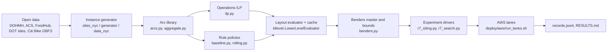

# Where to place e-bike battery-swapping stations in Manhattan

New York City is moving delivery e-bike charging out of homes. It must decide where public battery-swapping and
charging stations should go. Delivery platforms do not share trip data. So this repository builds a simulator of
e-bike battery swapping from **public data only** and uses it to choose station sites, roles and sizes in
Manhattan south of 110th Street. Every answer comes with a **lower bound**, so we know how far it can be from the
best possible layout.

A paper on this work is in preparation.

**Short answer.** One station: put it in the corridor between 13th and 54th Street. DOT's proposed Site 34
(2nd Ave & E 13th St) is best. Two stations cut the daily cost by a third. Swap and charge at the same site.
Rule-based layouts and the 2024 DOT pilot pair cost 92-141 USD per day more.


## 1. Method

### 1.1 The question

A planner has a budget in units of 52,150 USD. One unit buys one swap-and-charge site with 3 spare batteries and
2 chargers. For each budget the planner picks:

* **sites** from 59 candidates (45 from public records, 14 restaurant-dense grid cells);
* a **role** per site: swap-and-charge (SC), swap-only cabinet (S) or charging hub (C);
* a **size** per site: an SC site has $`B \in \{2,3,4\}`$ spare batteries and $`C \in \{1,2\}`$ chargers;
  a swap-only cabinet $`B \in \{2,3\}`$; a hub $`C \in \{2,4\}`$ (hubs only at 12 places).

A layout is scored by its expected **daily cost**: set-up per day plus the operating cost of the 16:00-20:00
dinner peak, averaged over 12 demand evenings.

### 1.2 An open-data modular simulator

The simulator has six modules. Each can be replaced with better data or a better model without touching the rest.

| Module | What it does | Main code |
|---|---|---|
| Demand generation | Orders from restaurant inspections, census profiles and a public order sample | `generator.py`, `data_nyc.py`, `acs_weights.py` |
| Rider behavior | Coordinated plan (integer program); rule-based and own-choice riders as alternatives | `arcs.py`, `ilp.py`, `aggregate.py`, `baseline.py`, `rolling.py` |
| Station placement | Candidate sites, role and size menu, layout search and bounds | `sites_nyc.py`, `bilevel.py`, `benders.py` |
| Battery stock and charging | Station stock by charge level, chargers, site and feeder power limits | `ilp.py`, `evaluate.py` |
| Swap queue and service | Swap positions and swap time per site | `ilp.py`, `baseline.py` |
| Policy limits and prices | Costs, time-of-use electricity, penalties | `costs.py`, `or_instance.py` |

### 1.3 Two-stage (bi-level) model

**Upper level (planner).** Binary $w_{l\psi}=1$ if option $\psi$ (role, $B$, $C$) is built at location $l$.
At most one option per location, total investment within $m$ budget units, at least one swap-capable site, and a
charge-capable partner for every swap-only cabinet. The layout is $x=(y,B,C)$.

```math
V(x)=\mathrm{setup}(x)+\sum_{\xi\in\Xi} p_\xi\,\mathrm{OPEX}_\xi(x),\qquad
V^*_m=\min_{x\in\mathcal X_m} V(x)
```

**Lower level (operations).** For a fixed layout and one evening $\xi$, $\mathrm{OPEX}_\xi(x)$ is the optimum of a
time-expanded integer program. Time has 48 slots of 5 min. A battery has 24 levels of 25 Wh. A rider state is a node
(place, time, charge level). The program chooses:

* **dispatch**: one path per rider through wait, reposition, delivery, swap and terminal arcs; each order is
  served once or left unserved (60 USD penalty);
* **swaps**: a swap takes a full battery out of the station and puts the rider's battery in;
* **level-indexed station stock** $n_{jqt}$ with the balance

```math
n_{j,q,t+1}=n_{jqt}-c_{jqt}+c_{j,q-1,t}+s_{jqt}-\mathbf 1[q=L]\,S_{jt}-D_{jqt}+A_{j,q,t+1}
```

* **charging**: at most $C_j$ batteries per slot, site power $P_j$, and a shared feeder limit;
* **transfers**: a timetabled service may move up to 6 batteries between two open sites within 2 km.

The cost is electricity + riding + transfers + unserved orders + response time and lateness. The follower minimises
the planner's own operating cost, so the bi-level model equals a two-stage stochastic integer program.

**Exact rider aggregation.** Riders with the same start node and the same arc set form a class. If every class is
closed, the per-rider binaries become integer flows on one union network with the same optimum (proved in the
paper; implemented as `ilp.build_model(aggregate=True)`). This makes the model several times smaller.

### 1.4 Upper and lower bounds

Pricing one layout means 12 integer programs of minutes each. So for each budget we report an upper bound
$`\mathrm{UB}_m`$ (the best layout found) and a lower bound $`\mathrm{LB}_m`$.

**Two rider conventions.** *All-candidates* riders may reposition toward any candidate, even a closed one (the model
of record). *Open-sites* riders reposition only toward open sites and depots. The open-sites library is a subset, so

```math
\mathrm{OPEX}^{\mathrm{all}}_\xi(x)\le \mathrm{OPEX}^{\mathrm{open}}_\xi(x).
```

Every priced cost (open-sites) is an upper bound under both conventions. Every all-candidates lower bound is valid
under both. Open-sites integer-program bounds are used only in open-sites statements.

* **Upper bounds:** open-sites pricing of candidate layouts.
* **Safe Lagrangian Benders cuts:** take any multipliers $\lambda$ of the scenario LP, project them to the dual
  sign, recompute the reduced costs $\tilde c=c-A^\top\lambda$, and use the column bounds:

```math
\Theta_\xi\ \ge\ \beta^0_\xi+\beta_\xi^\top x,\qquad
\beta^0_\xi=\lambda^\top b+\sum_{\text{cols}}\min\{\tilde c\,\underline\zeta,\ \tilde c\,\overline\zeta\},\quad
\beta_\xi=-T^\top\lambda .
```

  The cut holds at every layout whatever the solver accuracy. Integer L-shaped cuts and cover rows are added too.
* **Root LP:** all candidates open with free sizes, once per scenario; a floor for every layout.
* **Regional superset bound and pair screen:** opening a site only adds options (with relaxed end targets). So the
  LP with all sites of a region open and free sizes bounds every layout inside that region. For a pair of sites
  this gives a screen: drop the pair if its bound is above the best cost found.
* **Certificate:** budget $m$ is certified when $`\mathrm{UB}_m-\mathrm{LB}_m\le\max\{0.01\,\mathrm{UB}_m,1\}`$.
  At one unit all 236 layouts are enumerated with pruning.

Comparisons between layouts are paired on the same scenarios, with stratified 95 % intervals (6 df over the 12
in-sample evenings; 3 df for the held-out weekday check).

## 2. Code logic



The arc library is shared by the ILP and the rule policies, so both are priced on the same moves. Every schedule
is re-checked by `evaluate.check`. The evaluator caches each (layout, scenario) solve. The master turns LP duals
into safe cuts. Every driver stage appends to `records.jsonl` and resumes from it.

### Main modules

All paths are under `ebike_swap_sim/`.

| Path | Role |
|---|---|
| `ebike_swap_sim/or_instance.py` | Data model: discretisation, riders, orders, facilities, transfer services |
| `ebike_swap_sim/generator.py` | Synthetic and round-5 instance families |
| `ebike_swap_sim/data_nyc.py`, `acs_weights.py` | NYC restaurants, census zone weights, order destinations |
| `ebike_swap_sim/sites_nyc.py` | Candidate sites (`manhattan_dot` family), size menu, layout to instance |
| `ebike_swap_sim/arcs.py` | Time-expanded arc library and pruning rules |
| `ebike_swap_sim/aggregate.py` | Exact rider aggregation and path decomposition |
| `ebike_swap_sim/ilp.py` | Gurobi operations model, MIP starts, solution extraction |
| `ebike_swap_sim/evaluate.py` | Cost function and constraint checker for any schedule |
| `ebike_swap_sim/baseline.py` | Event-driven rule policy (nearest rider, threshold swaps) |
| `ebike_swap_sim/rolling.py` | Rolling-horizon wrapper (online re-planning) |
| `ebike_swap_sim/bilevel.py` | `LowerLevelEvaluator`, search heuristics, rule baselines |
| `ebike_swap_sim/benders.py` | Scenario LPs, safe cuts, cut pool, master, subset bounds |
| `ebike_swap_sim/costs.py` | Cost calibration in USD |
| `experiments/r7_siting.py` | Siting driver: setup, feas, rootlp, m1, comparison, restricted, oos, analyse |
| `experiments/r7_search.py` | Search driver: pairs, m3, roles, oos, noradius, price-list, ub-check, report |
| `experiments/r7_gate.py`, `r7_cost.py` | Pre-run gate check; compute-cost summary of `cost.jsonl` |
| `tests/` | About 480 pytest checks |

### Install

Python 3.12 and Gurobi (`gurobipy` 13) with a licence. A free academic licence works.

```bash
git clone https://github.com/yuanmingchen922/Ebike_battey_swap.git
cd Ebike_battey_swap
python3.12 -m venv .venv && . .venv/bin/activate
pip install -r deploy/aws/requirements.txt
export GRB_LICENSE_FILE=/path/to/gurobi.lic   # never commit the licence
```

`import ebike_swap_sim` works without Gurobi; only the solver modules need it.

### Tests and a smoke run

```bash
cd ebike_swap_sim
python3 -m pytest                                   # pytest.ini sets the path
PYTHONPATH=. python3 experiments/e1_toy.py          # toy example, optimum 12.5
PYTHONPATH=. python3 experiments/r7_siting.py --smoke --stage all   # toy siting run -> outputs/r7_siting_smoke/
PYTHONPATH=. python3 experiments/r7_siting.py --stage setup --dry-run --lp-workers 1 --price-workers 1   # sizes of the real instance, no solve (several minutes)
```

### The production siting run

The production run uses the `manhattan_dot` family: 59 candidates, 12 scenarios plus 12 held-out, 8 riders,
14-block approach radius. It ran on one AWS r7i.4xlarge in 48.1 instance hours (50.87 USD).

1. `r7_siting.py --stage feas` screens which sites can work alone.
2. `r7_siting.py --stage rootlp` solves the root LP per scenario.
3. `r7_siting.py --stage m1` enumerates one-site layouts; `r7_search.py --stage price-list --tier open_sites`
   prices the open-sites list.
4. `r7_search.py --stage pairs`, `m3`, `roles` search two and three units.
5. `r7_siting.py --stage comparison` and `restricted` price the rules, the DOT pilot pair and the DOT-only search.
6. `r7_search.py --stage oos` and `noradius` re-price on held-out scenarios and without the approach radius.
7. `r7_siting.py --stage analyse` and `r7_search.py --stage report` write `RESULTS.md` and `SEARCH.md`.

All stages share `--out-dir` (default `outputs/r7_siting/`) and resume from its records. The lane plans are written
with `--write-lanes` (`r7_search.py --write-lanes --lanes-plan r2` writes
`outputs/cloud_lanes_siting_prod/lanes_r2.txt`). On AWS (`deploy/aws/`):

```bash
# laptop
deploy/aws/sync_up.sh                 # code and data to the server
deploy/aws/upload_licence.sh          # Gurobi licence to the server (mode 600)
# server (~/battery_swap)
bash deploy/aws/bootstrap.sh          # venv, licence check, toy optimum 12.5, smoke stage
bash deploy/aws/r7_prod_check.sh      # pre-flight check of code and lane plans
. env.sh                              # venv, licence, cd ebike_swap_sim
bash ../deploy/aws/run_lanes.sh start outputs/cloud_lanes_siting_prod/lanes_r2.txt
bash ../deploy/aws/run_lanes.sh status outputs/cloud_lanes_siting_prod/lanes_r2.txt
# laptop
deploy/aws/sync_down.sh               # results back
```

Copy `deploy/aws/aws_env.example.sh` to `aws_env.sh` first (git-ignored). Final report:
`ebike_swap_sim/outputs/r7_prod_final/RESULTS_final.md`.

## 3. Results

All values are USD per day, set-up included. Every cost is an open-sites cost.

| Budget | Best layout found | Cost | Lower bound | Gap |
|---|---|---|---|---|
| 1 unit | DOT Site 34, open-sites riders | 1,085.87 | 1,084.31 | **0.14 %** (certified) |
| 1 unit | same, all-candidates riders | 1,085.87 | 1,036.03 | 4.59 % |
| 2 units | Greenwich Village grid cell + Citi Bike dock 3rd Ave & E 62nd St | 716.85 | 670.23 | 6.50 % |
| 2 units | all-DOT pair: Site 34 + the same dock | 719.60 | | |
| 3 units | best pair, 4 spares each | 709.98 | 670.23 | 5.60 % |

### Finding 1: one site belongs in a corridor, led by DOT Site 34

* Site 34 (2nd Ave & E 13th St) costs 1,085.87 and serves 77.5 % of orders.
* For open-sites riders it is certified within 0.14 % of the best single site.
* For all-candidates riders the gap is 4.59 %; Site 34 is not proven best there.
* 11 sites lie within 3 %, all between 13th and 54th Street. Only 23 of 59 candidates can work alone.
* The approach radius changes the order: without it three Midtown sites tie and Site 34 is eighth.

### Finding 2: a second site cuts cost by a third

* The best pair costs 716.85: 34 % less than one site. It serves 98.3 % of orders.
* Unserved orders fall from 9.5 to 0.74 per day.
* The all-DOT pair (Site 34 + the E 62nd St dock) is only $2.75 \pm 10.58$ more. A planner limited to listed
  sites loses almost nothing.
* A third budget unit buys batteries, not a third site: one more spare at both sites gives 709.98. The best
  three-site layout priced costs $8.82 \pm 2.46$ more.


### Finding 3: swap and charge at the same site

* A swap-only cabinet plus a separate charging hub costs $728.92 \pm 65.93$ more. The hub stays idle: in a
  four-hour evening it cannot return charged batteries in time.
* A swap-only cabinet beside a full site costs $41.49 \pm 7.66$ more.

### Finding 4: better than rules and the 2024 pilot

| Two-site layout | Extra cost (in sample) | Held-out weekdays (3 df) | Open-sites regret interval |
|---|---|---|---|
| Spread rule | $+91.70 \pm 37.08$ | not measured | [89.09, 138.33] |
| DOT 2024 pilot pair (Cooper Sq + Essex Market) | $+134.42 \pm 37.70$ | $+143.12 \pm 84.05$ | [130.86, 181.04] |
| Coverage rule | $+141.48 \pm 38.12$ | $+130.37 \pm 84.01$ | [136.19, 188.10] |

Held-out values cover weekday scenarios only (strata 1-3, stratified interval with 3 df); weekend held-out cells
were not solved. The losses come almost entirely from 2.4 to 3.7 unserved orders per day. The best pair puts one site on each side
of the island.


### Context

* **DOT 2024 pilot:** five public charging and swapping hubs (March-September 2024, swapping until February 2025);
  two of them, Cooper Square and Essex Market, lie in our area.
* **PEC programme:** DOT's Public E-Bike Charging programme has proposed 50 sidewalk sites citywide and will keep
  about 25; a vendor call is planned for late 2026.
* **Site 34:** a PEC proposal at the southeast corner of 2nd Ave and E 13th St, about 600 m from Cooper Square.

### Checks on the operations model (earlier rounds)

* Against the best of three rules, the coordinated plan is 25.1 % cheaper (95 % CI 20.2-30.1) on 30 synthetic
  instances and at least 27.9 % cheaper (24.2-31.6) on 10 Midtown instances. 99.8 % of the saving comes from
  serving more orders sooner.
* Rolling re-planning keeps about half of that saving (ratio of means 0.42 and 0.53).
* No battery moved by transfer in 45 solves without end targets.
* Removing on-site charging costs 262.96 USD more per window (216.81-309.11).

Sources: `ebike_swap_sim/outputs/R6_DIGEST.md` and `R6_FILL_DIGEST.md`.

### What is proven and what is not

* **Proven:** Site 34 is the best single site within 0.14 % for open-sites riders. For open-sites riders, the rule
  and pilot layouts lose at least 33-136 USD per day (all regret intervals above zero).
* **Not proven:** the one-site optimum for all-candidates riders (gap 4.59 %). The two- and three-unit answers are
  the best found by a heuristic pair search (gap 5.6-6.5 %); 11 screened pairs could not be ruled out.

### Limitations

* 12 demand evenings, 8 riders and about 40 orders per evening; the held-out check covers weekdays only.
* A four-hour evening is too short for transfers or hubs to pay. End-of-evening stock is not valued.
* Riders follow a coordinated full-information plan; real online costs would be higher.
* Citi Bike docks stand in for "a sidewalk place with power". Grid cells are not addresses. Cabinet space and
  owner consent were not checked.

## 4. Reference reading

1. D. Ding, Z. Li, J. Zhang, X. Liu, J. Zhang, Y. Li, P. Cai, J. Liu, G. Long. "eBaaS: AIoT-Enabled eBike
   Battery-Swap as a Service for Last-Mile Delivery." *Proc. ACM Web Conference (WWW '25)*, 2025, pp. 5045-5053.
   https://doi.org/10.1145/3696410.3714503. *Use:* energy calibration (25 Wh/km) and the 2 km service radius.
2. W. Li, Z. Li, X. Liu, R. Zhu, Z. Zheng, F. Wu. "Optimizing the Battery-Swapping Problem in Urban E-Bike
   Systems with Reinforcement Learning." *Proc. IJCAI-25*, 2025, pp. 9259-9267.
   https://doi.org/10.24963/ijcai.2025/1029. *Use:* battery rebalancing between stations; cost-aware transfer rule.
3. Y. Xiong, J. Gan, B. An, C. Miao, A. L. C. Bazzan. "Optimal Electric Vehicle Charging Station Placement."
   *Proc. IJCAI-15*, 2015, pp. 2662-2668. https://www.ijcai.org/Abstract/15/377. *Use:* budgeted bi-level siting;
   our coverage and spread rules.
4. J. Dumouchelle, R. Patel, E. B. Khalil, M. Bodur. "Neur2SP: Neural Two-Stage Stochastic Programming."
   *Advances in Neural Information Processing Systems 35 (NeurIPS 2022)*, pp. 23992-24005.
   https://doi.org/10.52202/068431-1742 (arXiv 2205.12006). *Use:* a learned surrogate for a faster pair search.
5. J. Luke, M. Salazar, R. Rajagopal, M. Pavone. "Joint Optimization of Autonomous Electric Vehicle Fleet
   Operations and Charging Station Siting." *2021 IEEE ITSC*, pp. 3340-3347.
   https://doi.org/10.1109/ITSC48978.2021.9565089 (arXiv 2107.00165). *Use:* location-time-charge network for
   siting with operations; idea behind rider aggregation.

Longer notes on each paper are in [`reading/README.md`](reading/README.md). The PDFs are not in the repository.

### Data sources

* NYC DOT, *Safer Charging, Safer Deliveries: Lessons from NYC DOT's Public E-Bike Charging Pilot*, 2024.
  https://www.nyc.gov/html/dot/downloads/pdf/safer-charging-safer-deliveries.pdf
* NYC DOT, Public E-Bike Charging (PEC) proposed sites. https://nycdotprojects.info/project/1995/overview
* NYC DOHMH restaurant inspection results (NYC Open Data 43nn-pn8j). https://data.cityofnewyork.us/d/43nn-pn8j
* NYC DCP, American Community Survey 2020-2024 neighborhood profiles.
  https://www.nyc.gov/content/planning/pages/resources/datasets/american-community-survey
* FoodHub food ordering and delivery dataset (Kaggle).
  https://www.kaggle.com/datasets/ahsan81/food-ordering-and-delivery-app-dataset
* Citi Bike GBFS station information (field `is_charging`).
  https://gbfs.lyft.com/gbfs/2.3/bkn/en/station_information.json

Download commands and checksums are in [`data/MANIFEST.md`](data/MANIFEST.md); the candidate list is
`data/raw/dot_candidate_sites.csv`.

## 5. Earlier rounds

The siting study (round 7) builds on six earlier rounds of work on the operations model.

| Round | Topic | Report |
|---|---|---|
| 1-3 | Operations ILP vs rule policy; transfers, sizing, Midtown instance | `notes/SUMMARY.md`; `ebike_swap_sim/outputs/e1/RESULTS.md`; `ebike_swap_sim/outputs/{e2u,e3u,e4u,e8}_round3/RESULTS_final.md` |
| 4 | First bi-level siting on 12 Midtown candidates | `ebike_swap_sim/outputs/e9_bilevel/RESULTS_E9.md` |
| 5 | Reading-list extensions: aggregation, rolling horizon, network, RL, Manhattan family | `ebike_swap_sim/outputs/R5_DIGEST.md`; `ebike_swap_sim/outputs/r5_x*/RESULTS_final.md` |
| 6 | Penalty recalibration, re-runs, first Manhattan siting pass | `ebike_swap_sim/outputs/R6_DIGEST.md`, `ebike_swap_sim/outputs/R6_FILL_DIGEST.md`; `ebike_swap_sim/outputs/r6_penalty/`, `ebike_swap_sim/outputs/r6_fill/`, `ebike_swap_sim/outputs/r6_o2/RESULTS_final.md` |
| 7 | Production siting on 59 DOT-based candidates | `ebike_swap_sim/outputs/r7_prod_final/RESULTS_final.md` |

Modelling decisions are recorded in `notes/DECISIONS.md`; the siting design is in `notes/bilevel_siting_design.md`
and `notes/siting_scaleup_design.md`.

## 6. Repository map

```
.
├── README.md                 this file
├── docs/figs/                figures used in this README
├── data/                     public raw data, MANIFEST.md, validate.py
├── food_order.csv            FoodHub order sample (preparation times, cuisine mix)
├── reading/README.md         reading notes on the five papers
├── notes/                    design notes, decisions, cost calibration, dataset notes
├── deploy/aws/               AWS scripts: sync, bootstrap, lane dispatcher, pre-flight check
└── ebike_swap_sim/
    ├── ebike_swap_sim/       the package (model, data, siting, bounds)
    ├── experiments/          one driver per experiment and round (r7_siting.py, r7_search.py, ...)
    ├── tests/                pytest suite
    └── outputs/              records and reports per experiment
```

Not in the repository: the Gurobi licence, AWS keys and connection file, per-solve caches and snapshots,
copyrighted PDFs, and paper drafts.
